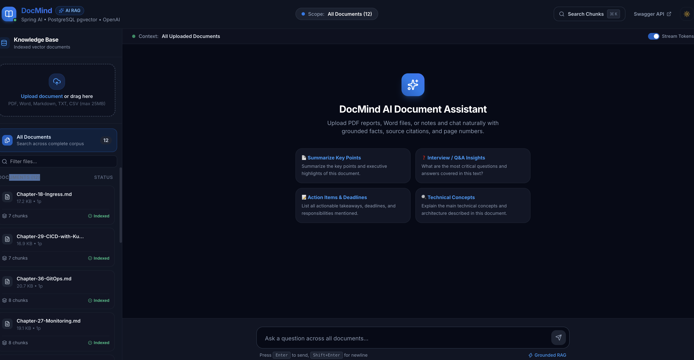
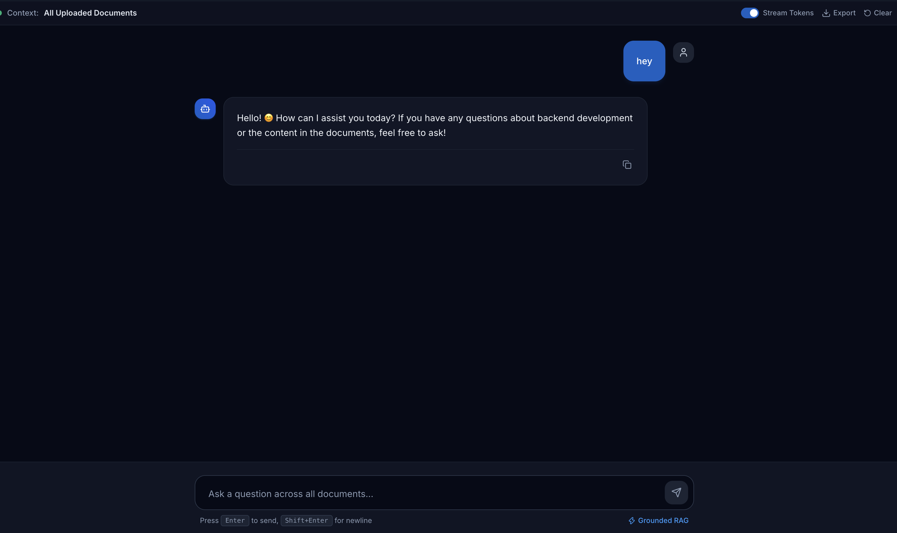
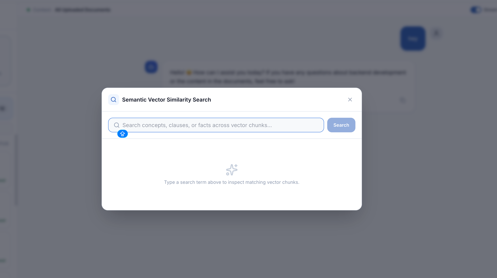
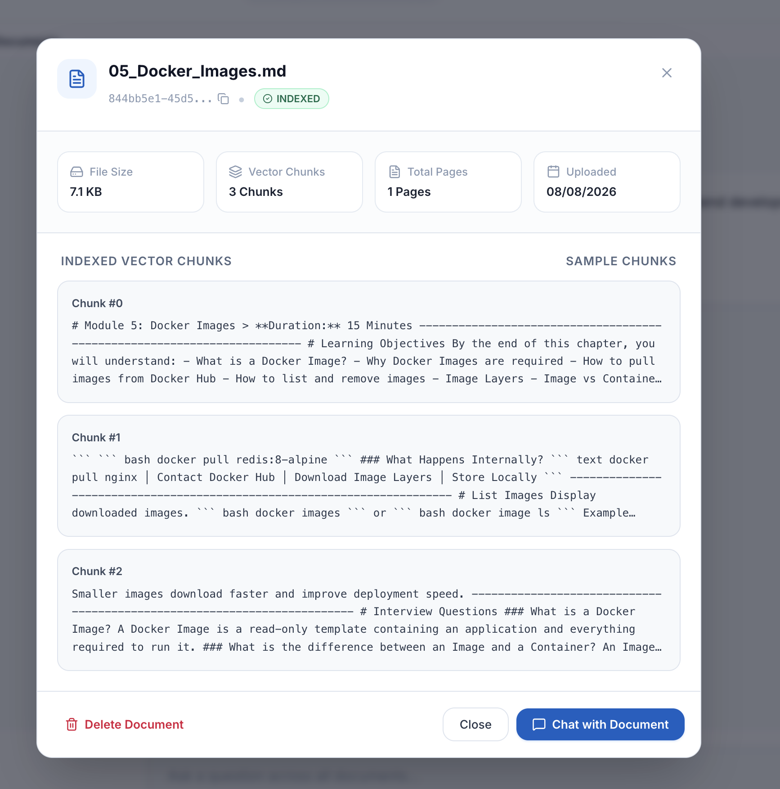
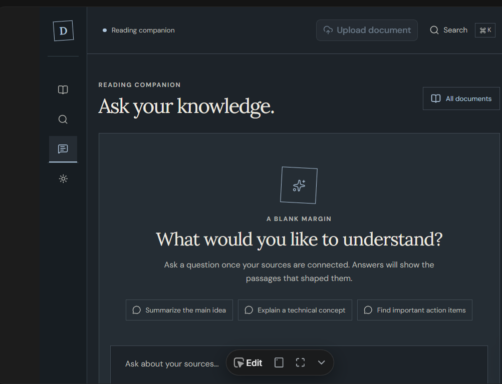
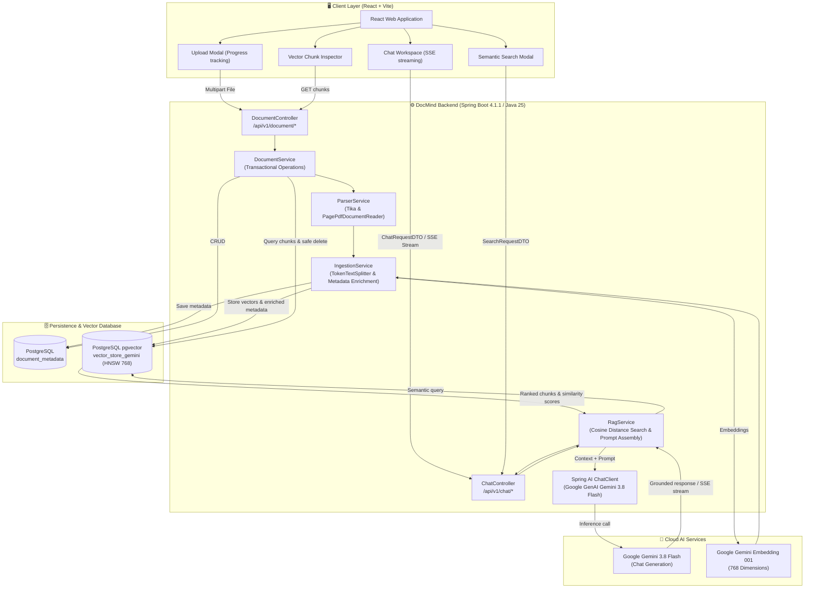
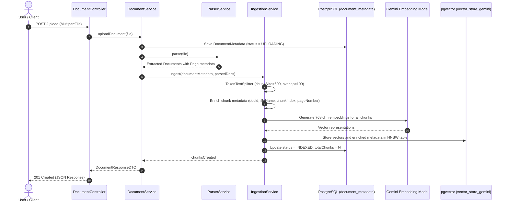
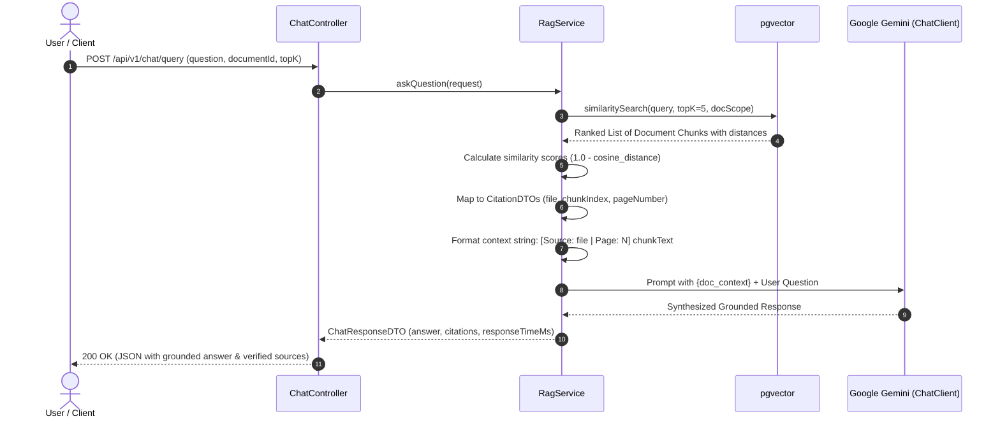

# DocMind — AI Document Intelligence & RAG Platform

<div align="center">

[](https://spring.io/projects/spring-boot)
[](https://spring.io/projects/spring-ai)
[](https://www.oracle.com/java/)
[](https://react.dev/)
[](https://tailwindcss.com/)
[](https://www.postgresql.org/)
[](https://github.com/pgvector/pgvector)
[](https://ai.google.dev/)
[](https://www.docker.com/)

<p align="center">
  <strong>DocMind</strong> is an enterprise-grade, full-stack <strong>Retrieval-Augmented Generation (RAG)</strong> and document intelligence platform. It allows users to ingest heterogeneous multi-format documents (PDF, DOCX, Markdown, TXT, CSV), automatically extracts and segments them into token-bounded semantic chunks, creates high-dimensional vector embeddings, and stores them in a <strong>PostgreSQL + pgvector</strong> vector database.
</p>
<p align="center">
  Users can chat naturally with single documents or entire knowledge corpora with <strong>verifiable source citations</strong> (file names, chunk IDs, page numbers), stream responses token-by-token via <strong>Server-Sent Events (SSE)</strong>, execute deep <strong>semantic vector similarity searches</strong>, and inspect document vector chunks with a sleek, responsive interface.
</p>

[Key Features](#-key-features) • [Application Screenshots](#-application-screenshots) • [Architecture](#-system-architecture) • [Tech Stack](#-technology-stack) • [API Documentation](#-rest-api-reference) • [Getting Started](#-getting-started) • [Configuration](#-configuration)

---

</div>

## 📑 Table of Contents

- [🌟 Key Features](#-key-features)
- [📸 Application Screenshots](#-application-screenshots)
  - [1. Knowledge Base Dashboard & Corpus Overview](#1-knowledge-base-dashboard--corpus-overview)
  - [2. Conversational RAG with Grounded Citations & Streaming](#2-conversational-rag-with-grounded-citations--streaming)
  - [3. Deep Semantic Vector Similarity Search](#3-deep-semantic-vector-similarity-search)
  - [4. Vector Chunk Inspector & Diagnostics](#4-vector-chunk-inspector--diagnostics)
  - [5. Dark Mode & Editorial Reading Companion](#5-dark-mode--editorial-reading-companion)
- [🏗️ System Architecture](#️-system-architecture)
  - [Document Ingestion & Indexing Pipeline](#document-ingestion--indexing-pipeline)
  - [Retrieval-Augmented Generation (RAG) & Chat Lifecycle](#retrieval-augmented-generation-rag--chat-lifecycle)
- [💻 Technology Stack](#-technology-stack)
- [🔌 REST API Reference](#-rest-api-reference)
  - [Document Management Endpoints](#document-management-endpoints)
  - [Chat & Vector Search Endpoints](#chat--vector-search-endpoints)
  - [Sample JSON Payloads](#sample-json-payloads)
- [🚀 Getting Started](#-getting-started)
  - [Prerequisites](#prerequisites)
  - [1. Clone Repository](#1-clone-repository)
  - [2. Start Vector Database (PostgreSQL + pgvector)](#2-start-vector-database-postgresql--pgvector)
  - [3. Configure Environment & Run Backend](#3-configure-environment--run-backend)
  - [4. Install & Launch Frontend](#4-install--launch-frontend)
- [⚙️ Configuration](#️-configuration)
- [📁 Project Structure](#-project-structure)
- [🛡️ Error Handling & Transaction Safety](#️-error-handling--transaction-safety)
- [🤝 Contributing & License](#-contributing--license)

---

## 🌟 Key Features

- **Multi-Format Document Parsing & Ingestion**:
  - Automatically parses PDF documents (using Apache Tika and Spring AI `PagePdfDocumentReader`).
  - Supports Markdown (`.md`), Word (`.docx`), plain text (`.txt`), and CSV formats with rich metadata extraction.
  - Supports single file uploads and parallel multi-file batch uploads (`/upload-multiple`).
- **Semantic Text Chunking & Metadata Enrichment**:
  - Employs Spring AI's `TokenTextSplitter` with configurable chunk size (600 tokens), chunk overlap (100 tokens), and minimum length bounds.
  - Enriches every chunk with critical provenance tags: `documentId`, `fileName`, `contentType`, `chunkIndex`, and exact `pageNumber`.
- **PostgreSQL `pgvector` Store with HNSW Indexing**:
  - Uses 768-dimensional embeddings generated by Google Gemini (`gemini-embedding-001`) or OpenAI models.
  - Indexed with Hierarchical Navigable Small World (**HNSW**) graphs and **Cosine Distance** for sub-millisecond approximate nearest neighbor searches.
- **Grounded Conversational RAG with Strict Citations**:
  - Dual answering mode: prioritized answers grounded in retrieved document excerpts, combined with general conversational intelligence for chit-chat, summaries, or programming queries.
  - Every answer includes verified citations containing document ID, file name, chunk index, page number, and similarity confidence score.
- **Real-Time Token Streaming (SSE)**:
  - Supports reactive Server-Sent Events (`text/event-stream`) via Project Reactor `Flux<String>` to stream tokens progressively to the client with negligible time-to-first-token.
- **Direct Semantic Similarity Search**:
  - Dedicated search endpoint allowing users to search concepts, clauses, and facts across all or specific documents without invoking LLM generation.
- **Document Chunk Inspector & Transactional Cleanup**:
  - Transparent inspection modal to view raw chunk text, token indices, and page numbers.
  - Robust transactional document deletion: deletes vector embeddings from `vector_store_gemini` and metadata from PostgreSQL in a single atomic transaction.
- **Modern Responsive UI**:
  - Built with React, Vite, and Tailwind CSS.
  - Features real-time upload progress tracking, prompt template action chips, light/dark mode themes, and global keyboard shortcuts (`⌘K` / `Ctrl+K`).

---

## 📸 Application Screenshots

Below are relevant screenshots showcasing the live DocMind application in action:

### 1. Knowledge Base Dashboard & Corpus Overview
> Central workspace displaying indexed documents, status indicators (`INDEXED`, `PROCESSING`), document corpus counters, scope selector, quick prompt chips, and integrated Swagger documentation link.

<div align="center">
  
</div>

<br/>

### 2. Conversational RAG with Grounded Citations & Streaming
> Real-time conversational interface querying across document chunks. Displays conversation history, token streaming toggle, copy-to-clipboard, export transcripts, and grounded RAG answer generation.

<div align="center">
  
</div>

<br/>

### 3. Deep Semantic Vector Similarity Search
> Dedicated semantic search modal allowing users to query concepts, clauses, or facts directly against PostgreSQL vector embeddings with real-time similarity scoring.

<div align="center">
  
</div>

<br/>

### 4. Vector Chunk Inspector & Diagnostics
> Diagnostic modal revealing the exact chunk segmentation, file size, page count, and raw text chunks (`Chunk #0`, `Chunk #1`, `Chunk #2`) stored in `pgvector`. Provides direct "Chat with Document" scoping and safe deletion.

<div align="center">
  
</div>

<br/>

### 5. Dark Mode & Editorial Reading Companion
> Distraction-free editorial reading companion featuring instant prompt starters ("Summarize the main idea", "Explain a technical concept", "Find important action items") and keyboard navigation.

<div align="center">
  
</div>

---

## 🏗️ System Architecture

DocMind is decoupled into a high-performance **Spring Boot** service layer, a **PostgreSQL 16 + pgvector** persistence layer, a **Google GenAI / Gemini** LLM integration, and a modern **React + Tailwind** client.



### Document Ingestion & Indexing Pipeline



### Retrieval-Augmented Generation (RAG) & Chat Lifecycle



---

## 💻 Technology Stack

| Domain | Technology / Library | Version | Purpose |
|---|---|---|---|
| **Backend Framework** | [Spring Boot](https://spring.io/projects/spring-boot) | `4.1.1` | Core microservice framework, REST APIs, dependency injection |
| **Language** | [Java](https://openjdk.org/) | `25` | Modern LTS runtime with virtual threads and pattern matching |
| **AI Framework** | [Spring AI](https://spring.io/projects/spring-ai) | `2.0.1` | Vector store abstraction, model clients, token text splitters |
| **LLM & Embeddings** | [Google Gemini](https://ai.google.dev/) | `gemini-3.8-flash` / `gemini-embedding-001` | High-speed chat reasoning & 768-dimension semantic embeddings |
| **Vector Database** | [PostgreSQL + pgvector](https://github.com/pgvector/pgvector) | `pg16` | Relational document metadata + HNSW vector indexing |
| **Document Parsers** | [Apache Tika](https://tika.apache.org/) & Spring AI PDF | `3.1.1` | Multi-format content parsing (PDF, DOCX, TXT, CSV, MD) |
| **Tokenization** | [jtokkit](https://github.com/knuddels/jtokkit) | Latest | Exact BPE token counting for text chunk boundaries |
| **Reactive Streams** | [Project Reactor](https://projectreactor.io/) | Latest | Non-blocking Server-Sent Events (SSE) token streaming |
| **API Documentation**| [SpringDoc OpenAPI](https://springdoc.org/) | `3.1.1` | Interactive Swagger UI (`/swagger-ui.html`) & OpenAPI v3 specs |
| **Frontend Framework**| [React](https://react.dev/) + [Vite](https://vitejs.dev/) | `18.2` / `5.x` | Modern reactive frontend and blazing fast dev server |
| **Styling** | [Tailwind CSS](https://tailwindcss.com/) | `3.x` / `4.x` | Utility-first responsive design, dark mode, custom palettes |
| **Icons & UI** | [Lucide React](https://lucide.dev/) | Latest | Clean, accessible vector icons across desks and dialogs |
| **State Management**| [Zustand](https://zustand-demo.pmnd.rs/) / React Context | Latest | Global document store, active tabs, theme context |
| **Containerization** | [Docker & Docker Compose](https://www.docker.com/) | Compose v2 | Instant reproducible deployment of PostgreSQL `pgvector` |

---

## 🔌 REST API Reference

The backend exposes a fully documented REST API on port `8084` under `/api/v1`. Interactive Swagger UI is available at:
👉 `http://localhost:8084/swagger-ui.html`

### Document Management Endpoints

| Method | Endpoint | Request Body | Description |
|---|---|---|---|
| `POST` | `/api/v1/document/upload` | `multipart/form-data` (`file`) | Ingest, parse, chunk, embed, and index a single document. |
| `POST` | `/api/v1/document/upload-multiple` | `multipart/form-data` (`files`) | Batch upload and indexing of multiple files simultaneously. |
| `GET` | `/api/v1/document/listDocumets` | None | Returns metadata for all documents in the corpus. |
| `GET` | `/api/v1/document/{id}` | None (Path variable `id`) | Retrieve detailed metadata for a specific document. |
| `GET` | `/api/v1/document/{id}/chunks` | None (Path variable `id`) | Fetch all segmented vector chunks, page numbers, and indices. |
| `DELETE` | `/api/v1/document/{id}` | None (Path variable `id`) | Transactionally deletes vector embeddings and document metadata. |

### Chat & Vector Search Endpoints

| Method | Endpoint | Content-Type | Description |
|---|---|---|---|
| `POST` | `/api/v1/chat/query` | `application/json` | Non-streaming grounded RAG query returning answer, citations, and response timing. |
| `POST` | `/api/v1/chat/stream` | `text/event-stream` | Real-time Server-Sent Events (SSE) streaming answer tokens. |
| `POST` | `/api/v1/chat/search/similarity` | `application/json` | Pure semantic similarity search across vectors without LLM completion. |

---

### Sample JSON Payloads

#### 1. Ask Question (`POST /api/v1/chat/query`)

**Request:**
```json
{
  "question": "What is the policy for Kubernetes ingress controllers?",
  "documentId": "844bb5e1-45d5-45a2-9e91-88df5522b291",
  "topK": 5,
  "minSimilarity": 0.0,
  "conversationId": "c9284242-23c7-432d-96ab-2ba4313f8c85"
}
```

**Response (`200 OK`):**
```json
{
  "success": true,
  "message": "Answer is Processed",
  "data": {
    "answer": "Based on the provided documentation, Kubernetes Ingress acts as an API object that manages external access to services, typically HTTP and HTTPS. It provides load balancing, SSL/TLS termination, and name-based virtual hosting...",
    "conversationId": "c9284242-23c7-432d-96ab-2ba4313f8c85",
    "citations": [
      {
        "id": "844bb5e1-45d5-45a2-9e91-88df5522b291",
        "fileName": "Chapter-18-Ingress.md",
        "chunkIndex": 0,
        "pageNumber": 1,
        "snippet": "An API object that manages external access to the services in a cluster, typically HTTP...",
        "similarityScore": 0.8841,
        "metaData": {
          "documentId": "844bb5e1-45d5-45a2-9e91-88df5522b291",
          "fileName": "Chapter-18-Ingress.md",
          "contentType": "text/markdown"
        }
      }
    ],
    "responseTimeMs": 1420
  },
  "timestamp": "2026-10-19T18:10:00"
}
```

#### 2. Semantic Similarity Search (`POST /api/v1/chat/search/similarity`)

**Request:**
```json
{
  "query": "Docker image layers and cache invalidation",
  "documentId": null,
  "topK": 3,
  "similaritySearch": 0.65
}
```

**Response (`200 OK`):**
```json
{
  "success": true,
  "message": "Similar Chunks are Found",
  "data": {
    "query": "Docker image layers and cache invalidation",
    "totalMatches": 2,
    "matches": [
      {
        "id": "334f5521-12a4-4df2-a9b1-55bb3322a111",
        "fileName": "05_Docker_Images.md",
        "chunkIndex": 1,
        "pageNumber": 1,
        "snippet": "Each instruction in a Dockerfile creates a read-only layer. When building, Docker reuses cached layers unless files change...",
        "similarityScore": 0.892,
        "metaData": {
          "documentId": "334f5521-12a4-4df2-a9b1-55bb3322a111"
        }
      }
    ]
  }
}
```

#### 3. Inspect Document Chunks (`GET /api/v1/document/{id}/chunks`)

**Response (`200 OK`):**
```json
{
  "success": true,
  "message": "Document chunks fetched successfully",
  "data": [
    {
      "id": "3b29da48-9c12-4eb2-a6ee-0a1b8dbcd123",
      "chunkIndex": 0,
      "pageNumber": 1,
      "snippet": "# Module 5: Docker Images > Duration: 15 Minutes ...",
      "metadata": {
        "fileName": "05_Docker_Images.md",
        "chunkIndex": 0,
        "documentId": "844bb5e1-45d5-45a2-9e91-88df5522b291"
      }
    }
  ]
}
```

---

## 🚀 Getting Started

Follow the steps below to set up and run the entire DocMind platform locally:

### Prerequisites

- **Java JDK 21+** (Java 25 recommended): Verify with `java -version`.
- **Apache Maven 3.9+**: Verify with `mvn -version`.
- **Node.js 18+ & npm**: Verify with `node -v` and `npm -v`.
- **Docker Desktop**: Running locally to host PostgreSQL `pgvector`.
- **Google Cloud API Key**: A valid key with Gemini GenAI access enabled ([Google AI Studio](https://aistudio.google.com/)).

---

### 1. Clone Repository

```bash
git clone https://github.com/RainbowJaveline/DocMind---RAG-based-Document-Analyser.git
cd DocMind---RAG-based-Document-Analyser
```

---

### 2. Start Vector Database (PostgreSQL + pgvector)

The project includes a `docker-compose.yml` pre-configured with the `pgvector/pgvector:pg16` image on host port `5434`:

```bash
docker compose up -d
```

Verify that the container is healthy:
```bash
docker ps --filter "name=docMind_postgres"
```

The database initialization script (`init.sql`) automatically activates:
```sql
CREATE EXTENSION IF NOT EXISTS vector;
CREATE EXTENSION IF NOT EXISTS "uuid-ossp";
```

---

### 3. Configure Environment & Run Backend

Set your Google API Key as an environment variable (or configure it in `src/main/resources/application-dev.yml`):

**On Windows (PowerShell):**
```powershell
$env:GOOGLE_API_KEY="your-google-api-key-here"
$env:GOOGLE_CLOUD_PROJECT_ID="your-project-id"  # optional if not required by your key
```

**On Linux / macOS (Bash):**
```bash
export GOOGLE_API_KEY="your-google-api-key-here"
export GOOGLE_CLOUD_PROJECT_ID="your-project-id"
```

Build and run the Spring Boot service:
```bash
mvn clean spring-boot:run
```

The backend starts on:
- API Base: `http://localhost:8084`
- OpenAPI Specification: `http://localhost:8084/v3/api-docs`
- Swagger UI Console: `http://localhost:8084/swagger-ui.html`

---

### 4. Install & Launch Frontend

Open a new terminal session and navigate into the `Frontend` directory:

```bash
cd Frontend
npm install
npm run dev
```

Open your browser at:
👉 **`http://localhost:5173`** (or Vite allocated port)

The Vite dev server will proxy `/api` requests directly to `http://localhost:8084`.

---

## ⚙️ Configuration

Application parameters can be tuned in [`src/main/resources/application-dev.yml`](src/main/resources/application-dev.yml):

```yaml
spring:
  datasource:
    url: jdbc:postgresql://${DB_HOST:localhost}:${DB_PORT:5434}/${DB_NAME:docmind}
    username: ${DB_USERNAME:postgres}
    password: ${DB_PASSWORD:postgres}

  jpa:
    hibernate:
      ddl-auto: update
    show-sql: false

  ai:
    google:
      genai:
        api-key: ${GOOGLE_API_KEY}
        chat:
          model: ${GOOGLE_CHAT_MODEL:gemini-3.8-flash}
          temperature: 0.2
        embedding:
          text:
            model: ${GOOGLE_EMBEDDING_MODEL:gemini-embedding-001}
            dimensions: 768

    vectorstore:
      pgvector:
        index-type: hnsw
        distance-type: COSINE_DISTANCE
        dimensions: 768
        table-name: vector_store_gemini
        schema-name: public
        initialize-schema: true

  servlet:
    multipart:
      max-file-size: 25MB
      max-request-size: 50MB

app:
  rag:
    chunk-size: 600           # Target token length per chunk
    chunk-overlap: 100         # Token overlap between adjacent chunks
    min-chunk-size-char: 350   # Discard noise/tiny chunks below threshold
    min-chunk-length-to-embed: 5
    max-num-chunks: 10000
    top-k: 5                  # Number of relevant chunks retrieved per query
    similarity-threshold: 0.0 # Minimum cosine similarity cutoff (0.0 to 1.0)

  cors:
    allowed-origins: "*"
    allowed-methods: "GET,POST,PUT,DELETE"
    allowed-headers: "*"
```

---

## 📁 Project Structure

```text
DocMind/
├── docker-compose.yml               # PostgreSQL 16 + pgvector container definition
├── init.sql                         # Enables vector and uuid-ossp PostgreSQL extensions
├── pom.xml                          # Maven build descriptors (Java 25, Spring Boot 4.1.1, Spring AI)
├── docs/
│   └── screenshots/                 # Application visual screenshots
│       ├── 01-dashboard-overview.png
│       ├── 02-conversational-rag-chat.png
│       ├── 03-semantic-similarity-search.png
│       ├── 04-document-chunks-inspector.png
│       └── 05-dark-mode-reading-companion.png
├── src/
│   ├── main/
│   │   ├── java/DocMind/backend/
│   │   │   ├── BackendApplication.java       # Spring Boot main bootstrap class
│   │   │   ├── config/
│   │   │   │   ├── AppProperties.java        # Strongly typed configuration properties
│   │   │   │   ├── CorsConfig.java           # Cross-Origin Resource Sharing filters
│   │   │   │   └── ProjectConfig.java        # ChatClient prompt system instructions & Swagger OpenAPI
│   │   │   ├── Controller/
│   │   │   │   ├── ChatController.java       # RAG Q&A, SSE token stream, and similarity search APIs
│   │   │   │   └── DocumentController.java   # Document upload, chunk listing, and deletion APIs
│   │   │   ├── DTO/
│   │   │   │   ├── ApiResponse.java          # Uniform JSON envelope
│   │   │   │   ├── ChatRequestDTO.java       # Question, document scope, topK, minSimilarity
│   │   │   │   ├── ChatResponseDTO.java      # Answer, conversationId, citations, response latency
│   │   │   │   ├── CitationDTO.java          # Source filename, chunk index, page number, confidence
│   │   │   │   ├── DocumentChunkDTO.java     # Raw chunk content, index, page, metadata
│   │   │   │   ├── DocumentResponseDTO.java  # Metadata response (status, pages, chunk count)
│   │   │   │   ├── SearchRequestDTO.java     # Pure similarity search query
│   │   │   │   └── SearchResultDTO.java      # Ranked vector matches
│   │   │   ├── Entity/
│   │   │   │   ├── DocumentMetadata.java     # Relational entity for uploaded files
│   │   │   │   └── DocumentStatus.java       # Status enum (UPLOADING, PROCESSING, INDEXED, FAILED, DELETED)
│   │   │   ├── Exception/
│   │   │   │   ├── DocumentProcessingException.java
│   │   │   │   ├── ResourceNotFoundException.java
│   │   │   │   └── GlobalExceptionHandler.java# Centralized exception handler
│   │   │   ├── Repository/
│   │   │   │   └── DocumentMetaDataRepo.java # Spring Data JPA repository
│   │   │   └── Service/
│   │   │       ├── DocumentService.java      # Orchestrates parsing, ingestion, chunk querying & transactional delete
│   │   │       ├── IngestionService.java     # Text chunking, metadata enrichment, pgvector writes
│   │   │       ├── ParserService.java        # Multi-format document parsing (Apache Tika & PDF)
│   │   │       └── RagService.java           # Semantic retrieval, prompt composition, Gemini inference
│   │   └── resources/
│   │       ├── application.yaml              # Base application config (active profile: dev, port: 8084)
│   │       └── application-dev.yml          # Dev profile (Google GenAI, pgvector, HNSW, CORS)
│   └── test/                                # JUnit & Spring Boot integration test suites
└── Frontend/                                # React + Vite + Tailwind interactive web client
    ├── package.json                         # Frontend dependencies and build scripts
    ├── tailwind.config.js                   # Tailwind themes and dark mode configuration
    ├── vite.config.js                       # Vite dev server and proxy configuration
    ├── DOCMIND_FRONTEND_DOCS.md             # Dedicated frontend integration documentation
    └── src/
        ├── App.jsx                          # Main view router and layout
        ├── api/client.js                    # REST client with XHR progress & SSE token streaming
        ├── components/
        │   ├── chat/ChatSection.jsx         # Conversational Q&A desk with citations
        │   ├── search/SemanticSearch.jsx    # Vector similarity search modal
        │   ├── library/KnowledgeLibrary.jsx # Document management desk and metrics
        │   ├── library/SourceDetails.jsx    # Vector chunk inspector modal
        │   └── upload/UploadModal.jsx       # Single/batch drag-and-drop upload modal
        └── context/                         # DocumentContext and ThemeContext
```

---

## 🛡️ Error Handling & Transaction Safety

1. **Transactional Deletion Guarantee**:
   When a document is deleted via `DELETE /api/v1/document/{id}`, `DocumentService` executes a multi-step transactional process:
   - Queries `vector_store_gemini` to verify existing vector chunks matching the `documentId`.
   - Deletes all corresponding vector embeddings from `vector_store_gemini`.
   - Verifies that the count of deleted vectors matches the expected chunk count.
   - Deletes the relational record from `document_metadata`.
   - If vector deletion fails or mismatches, the transaction rolls back, preventing orphaned vector rows or ghost documents.
2. **Corrupted File Detection**:
   If an uploaded file cannot be parsed or yields zero readable text tokens, its status is marked as `FAILED` with a descriptive message, and the temporary metadata entry is cleaned up.
3. **Graceful Fallback for Non-Document Inquiries**:
   The `RagService` prompt instructs the model to prioritize document facts when matching context is retrieved. If the user asks general or chitchat questions with no relevant document matches, the assistant falls back to general knowledge while preserving a warm, structured response format.

---

## 🤝 Contributing & License

Contributions, issues, and feature requests are welcome! Feel free to check the [issues page](https://github.com/RainbowJaveline/DocMind---RAG-based-Document-Analyser/issues).

### License
This project is open-source and distributed under the **MIT License**.

---

<div align="center">
  <sub>Developed by <strong>Neal Mudaliar</strong> (<a href="https://github.com/RainbowJaveline">@RainbowJaveline</a>). Built with Spring AI, PostgreSQL pgvector, and Google Gemini.</sub>
</div>
